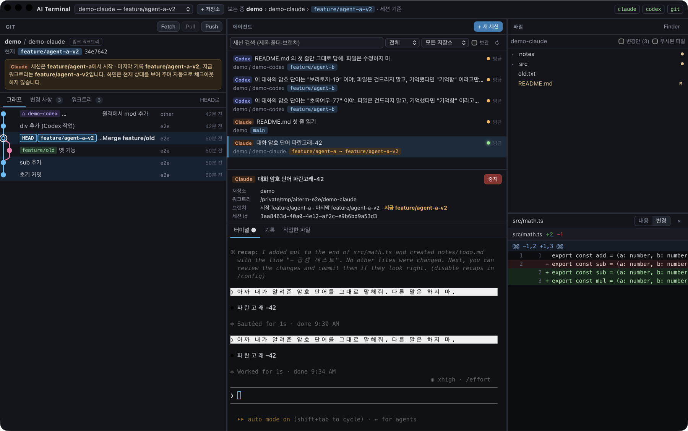

# AI Terminal

> macOS 용 오픈소스 AI 코딩 워크스페이스. Claude Code·Codex 세션이 **어느 저장소·워크트리·브랜치에서** 일하는지 실시간으로 보면서 대화하고 파일을 확인한다.
>
> An open-source macOS workspace for AI coding agents (Claude Code, Codex): see which repository, worktree and branch each session is working on, resume it in a real terminal, and watch the files it touches.



## 무엇을 하나

| 왼쪽 — Git | 가운데 — 에이전트 | 오른쪽 — 파일 |
|---|---|---|
| 커밋 그래프(레인), 브랜치·원격·태그·워크트리 HEAD 배지, 변경 사항·커밋, Fetch / Pull(ff-only) / Push, 확인창이 있는 명시적 체크아웃 | Claude Code·Codex 세션 목록(외부 터미널에서 시작한 것 포함), 기록 보기, `claude --resume` / `codex resume` 을 앱 안 터미널(PTY)로 재개, 새 세션, 여러 세션 동시 실행 | 세션 워크트리의 실제 파일 트리, 수정·추가·삭제 표시, 코드 미리보기, diff, 외부 변경 자동 갱신 |

**핵심 규칙**

- 가운데에서 세션을 고르면 왼쪽과 오른쪽이 **그 세션의 워크트리**로 바뀐다. 이때 체크아웃은 절대 하지 않는다. 화면만 바꾼다.
- 브랜치는 세 가지를 따로 보여 준다. 세션 **시작** 때 기록된 브랜치, **마지막 기록**의 브랜치, 워크트리의 **지금** 브랜치(Git 실시간)다. 서로 다르면 경고를 띄운다.
- 체크아웃·풀·푸시 같은 쓰기 작업은 버튼을 누르고 확인창을 거쳐야만 실행된다. 커밋하지 않은 변경이나 실행 중인 에이전트가 있으면 경고한다.
- 원본 CLI 를 그대로 실행하므로 기존 로그인과 구독, 권한 승인 화면, 슬래시 명령이 모두 그대로 동작한다.
- 계정 가입이 없다. 앱 자체는 네트워크 요청을 보내지 않는다(CSP 로 차단). 대화 기록은 Claude·Codex 원본 파일을 읽기만 한다.

## 설치

### 빌드된 앱

`AI Terminal_<버전>_aarch64.dmg` 를 열어 `AI Terminal.app` 을 응용 프로그램 폴더로 옮긴다.

> 아직 Apple 공증(notarization)을 받지 않은 ad-hoc 서명 빌드다. 인터넷에서 받은 경우 처음 열 때 막힌다.
> - macOS 14 이하: Finder 에서 앱을 **우클릭 → 열기**
> - macOS 15 이상: 한 번 열어 본 뒤 **시스템 설정 → 개인정보 보호 및 보안 → "그래도 열기"**
> - 또는 터미널에서 `xattr -dr com.apple.quarantine "/Applications/AI Terminal.app"`
>
> 직접 빌드한 앱에는 이 과정이 필요 없다.

### 필요한 것

- macOS 12 이상, Apple Silicon(arm64). Intel 맥은 소스에서 빌드해야 하며 아직 검증하지 않았다.
- `git`
- 쓰려는 에이전트 CLI 가 이미 로그인된 상태: [Claude Code](https://code.claude.com) (`claude`), [Codex CLI](https://github.com/openai/codex) (`codex`)

앱은 로그인 셸(`$SHELL -l -i`)의 환경변수를 읽어 `claude`·`codex`·`git` 을 찾는다. 그래서 volta·homebrew·`~/.local/bin` 에 설치한 CLI 도 Finder 에서 연 앱이 찾을 수 있다. 상단 오른쪽의 `claude` `codex` `git` 표시가 초록색이면 찾은 것이다.

### 소스에서 빌드

```bash
# 준비: Rust(rustup), Node 20+, pnpm
pnpm install
pnpm tauri dev          # 개발 모드
pnpm tauri build        # src-tauri/target/release/bundle/{macos,dmg}
pnpm check              # 타입 검사 + 프런트 테스트 + Rust 테스트
```

## 사용법

1. 위의 **+ 저장소** 로 로컬 Git 저장소(비공개 저장소 포함)를 추가한다. 에이전트 세션이 있었던 저장소는 자동으로 발견된다.
2. 가운데 목록에서 세션을 고른다. 외부 터미널에서 시작한 Claude Code·Codex 세션도 보인다. 고르면 왼쪽 그래프와 오른쪽 파일이 그 세션의 워크트리를 보여 준다.
3. **재개** 를 누르면 기록된 작업 폴더에서 `claude --resume <id>` 또는 `codex resume <id>` 가 앱 안 터미널로 실행된다. 이전 대화 맥락이 그대로 이어진다.
4. **+ 새 세션** (⌘N)으로 원하는 워크트리에서 새 에이전트를 시작한다. 여러 세션을 동시에 돌려도 되며, 세션을 바꿔도 다른 에이전트 프로세스는 계속 돈다.
5. 에이전트나 외부 에디터가 파일을 바꾸면 파일 트리와 변경 표시, diff, Git 상태가 자동으로 갱신된다.

| 단축키 | 동작 |
|---|---|
| ⌘N | 새 세션 |
| ⌘R | 세션·저장소·Git 다시 읽기 |
| ⌘[ / ⌘] | 이전 / 다음 세션 |
| ⌘1 ⌘2 ⌘3 | Git / 에이전트 / 파일 패널로 포커스 |
| ⌘↩ (커밋 메시지 칸) | 커밋 |

## 데이터와 프라이버시

| 무엇 | 어디 | 앱이 하는 일 |
|---|---|---|
| Claude Code 기록 | `~/.claude/projects/*/<id>.jsonl` (`CLAUDE_CONFIG_DIR` 지원) | 읽기만 함 |
| Codex 기록 | `~/.codex/state_*.sqlite`, `~/.codex/sessions/**/rollout-*.jsonl[.zst]` (`CODEX_HOME` 지원) | 읽기 전용으로 엶 |
| 앱 상태 | `~/Library/Application Support/dev.aiterminal.app/ai-terminal.sqlite3` | 저장소 목록, 세션↔워크트리 연결, 실행 이력, 화면 상태. 대화 내용은 저장하지 않음 |

네트워크로 나가는 것은 사용자가 누른 Git 원격 작업(fetch/pull/push)과, 사용자가 실행한 Claude·Codex CLI 자체의 통신뿐이다.

## 문서

- [docs/ARCHITECTURE.md](docs/ARCHITECTURE.md) — 도메인 모델(Repository·Worktree·AgentSession·AgentExecution), 아키텍처 결정과 근거
- [docs/FEATURES.md](docs/FEATURES.md) — 구현된 기능 / 아직 안 된 기능
- [docs/TEST_REPORT.md](docs/TEST_REPORT.md) — 실제 CLI 로 수행한 인수 테스트 결과와 한계

## 라이선스

MIT. GitKraken 의 정보 구조를 참고했지만 코드와 고유 디자인은 사용하지 않았다. 커밋 그래프 레인 알고리즘은 직접 구현했다(vscode-git-graph·gitamine 코드는 라이선스 때문에 사용하지 않음).
