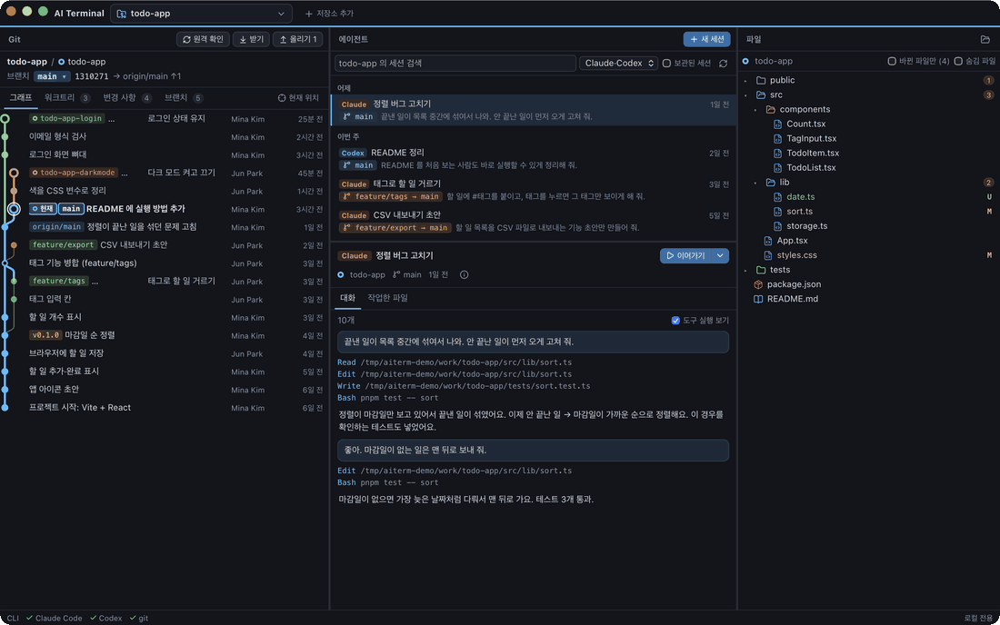
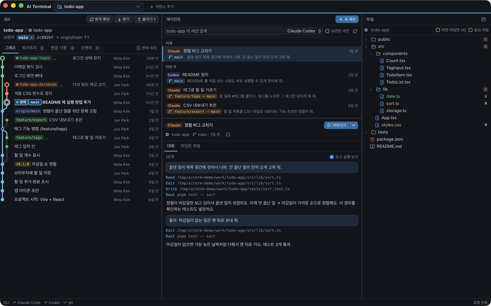
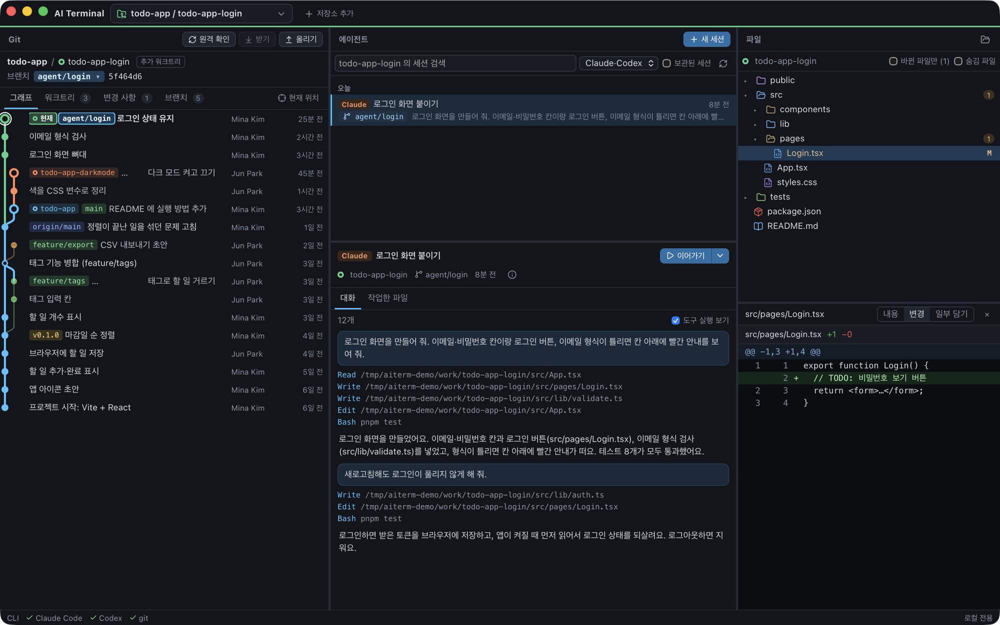
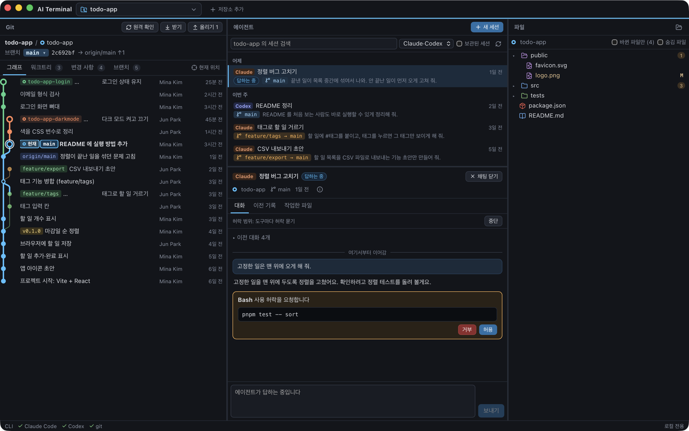
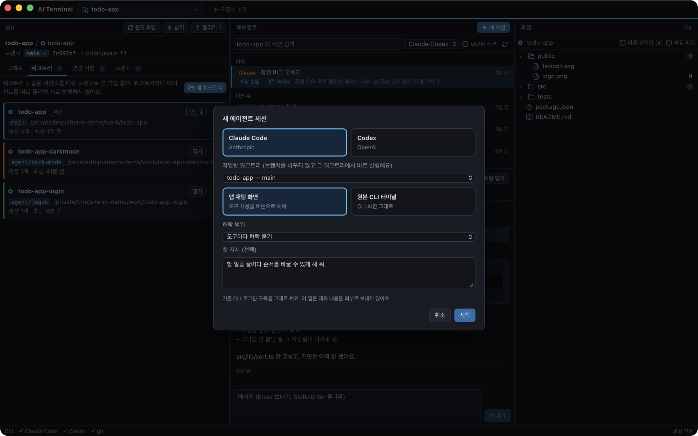
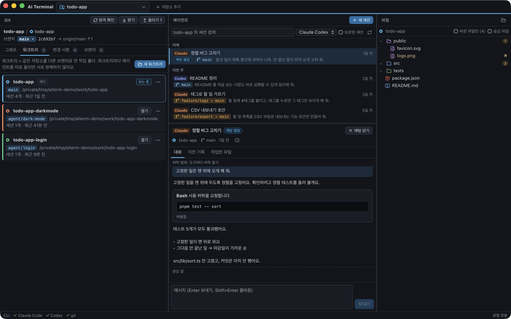
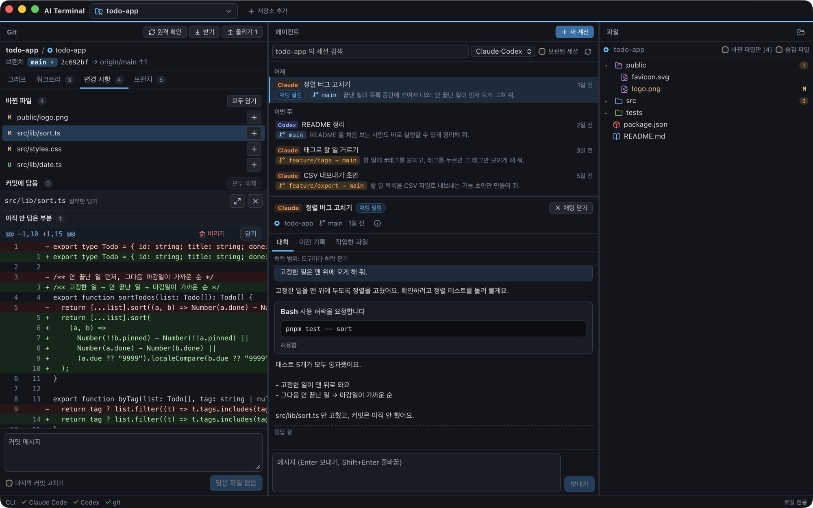
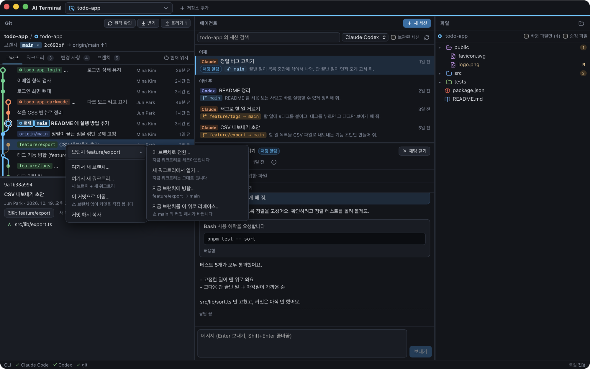
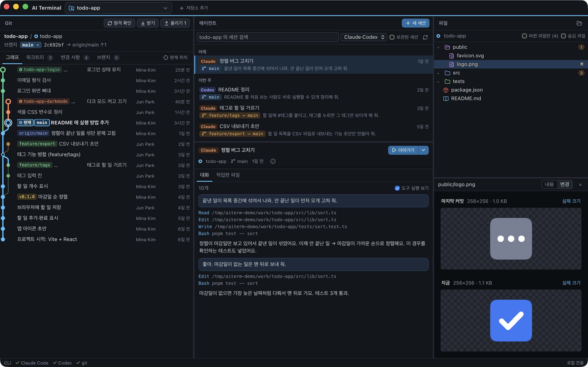

# 코드행방

**AI가 어디서 무엇을 바꾸는지**

기존 AI Terminal의 새 이름입니다. 기존 저장소와 세션 설정을 그대로 이어 씁니다. 이전 릴리즈의 파일명은 `AI-Terminal-…`일 수 있습니다.

**한국어** · [English](README.en.md)

<p align="center">
  
  <br><sub>30초 시연 (<a href="docs/demo.mp4">MP4 로 보기</a>) · 지어낸 예시 기록으로 찍었어요</sub>
</p>

<p align="center">
  <a href="https://github.com/whalebanana86/ai-terminal/releases/latest"><b>⬇︎ 내려받기 (macOS 12+, Apple 실리콘·인텔)</b></a>
</p>

내 맥에서 **Claude Code·Codex 를 여러 개 돌릴 때**, AI 가 저마다 **어느 저장소·워크트리·브랜치에서** 일하고 있는지 보면서 대화를 이어 가고, Git 과 파일까지 한 화면에서 확인하는 맥 앱이에요.

## 이 앱은 뭐예요?

요즘은 AI 에게 "로그인 화면 만들어 줘", "이 버그 고쳐 줘" 하고 말로 일을 시킬 수 있어요. 그런데 AI 를 두세 개 같이 돌리기 시작하면 금방 헷갈려요.

이 앱은 화면을 세 칸으로 나눠서

- **가운데**에 AI 와 나눈 대화(세션)를 모아 두고,
- 대화 하나를 고르면 **왼쪽 Git** 과 **오른쪽 파일**이 그 AI 가 일하던 곳으로 같이 바뀌어요.
- 마음에 들면 버튼 하나로 **그 대화를 이어서** 할 수 있어요.

마치 여러 친구가 각자 다른 책상에서 숙제를 할 때, 누가 어느 책상에서 무엇을 하고 있는지 한눈에 보이는 교실 지도 같은 거예요.



> 이 README 의 그림은 모두 지어낸 예시 기록(할 일 앱 저장소, 지어낸 사람 이름)으로 찍었어요. `scripts/make_screenshots.sh` 로 똑같이 다시 만들 수 있어요.

## 왜 만들었어요?

AI 에게 코드를 맡기다 보면 이런 일이 생겨요.

1. **"그 AI 지금 어느 브랜치에서 일하고 있지?"** — AI 마다 다른 폴더(워크트리)와 브랜치에서 일하는데, 터미널 창만 봐서는 잘 모르겠어요. 모르고 브랜치를 바꾸면 AI 가 갑자기 다른 파일을 보게 돼요.
2. **대화가 여기저기 흩어져 있어요** — 터미널 탭 여러 개, 다른 앱에서 연 것, 어제 닫은 것… 이어서 하려면 세션 id 를 찾아 명령을 직접 쳐야 해요.
3. **AI 가 바꾼 걸 보려면 앱을 또 열어야 해요** — 무엇이 바뀌었는지, 커밋할지 말지 보려면 Git 앱과 편집기를 따로 열어요.

그래서 이 앱은

- 내 맥의 Claude Code·Codex 대화를 **저장소·워크트리마다 모아 보여 주고**,
- 대화를 고르면 Git 과 파일을 **그 워크트리로 옮겨 보여 주되 체크아웃은 절대 하지 않고**(화면만 바뀌어요),
- **이어가기** 버튼 하나로 원래 CLI 그대로, 또는 앱 채팅 화면으로 대화를 이어 가요.

## 설치하는 방법

### 가장 쉬운 방법: 내려받기

1. [Releases 페이지](https://github.com/whalebanana86/ai-terminal/releases/latest)에서 `Code-Whereabouts-…-macOS.dmg` 를 내려받아요.
2. 내려받은 파일을 열고, **코드행방** 아이콘을 옆의 **Applications(응용 프로그램)** 폴더로 끌어다 놓아요.
3. 응용 프로그램 폴더에서 앱을 열어요.
   - "확인할 수 없는 개발자" 같은 창이 뜨면 **시스템 설정 → 개인정보 보호 및 보안** 맨 아래의 **그래도 열기**를 눌러요. (Apple 공증을 받기 전 버전이라 처음 한 번만 그래요.)
   - 터미널이 익숙하면 `xattr -dr com.apple.quarantine "/Applications/코드행방.app"` 한 줄로도 돼요.
4. 위쪽 **＋ 저장소 추가**로 내 Git 저장소 폴더를 골라요. AI 와 일한 적 있는 저장소는 알아서 찾아 줘요. Git 이 아닌 폴더를 고르면 "여기서 Git 을 시작할까요? (`git init`)"를 물어봐요(홈·시스템 폴더는 제외).

쓰려면 `git` 과, 이미 로그인된 [Claude Code](https://code.claude.com) (`claude`) 나 [Codex CLI](https://github.com/openai/codex) (`codex`) 가 있어야 해요.

### 코드로 직접 만들어 설치하기

10분쯤 걸려요(처음 한 번 Rust 가 많이 컴파일해요).

#### 준비물

- 맥 컴퓨터 (macOS 12 이상, Apple 실리콘 M1~). 인텔 맥은 아직 확인하지 않았어요
- `git` — 없으면 터미널에서 `xcode-select --install` 을 한 번 실행해요
- [Rust](https://rustup.rs) — `curl --proto '=https' --tlsv1.2 -sSf https://sh.rustup.rs | sh`
- [Node.js](https://nodejs.org) 20 이상과 [pnpm](https://pnpm.io) — `npm install -g pnpm`
- 쓰려는 AI 가 **이미 로그인된 상태**: [Claude Code](https://code.claude.com) (`claude`), [Codex CLI](https://github.com/openai/codex) (`codex`) 중 하나 이상

#### 따라 하기

1. **터미널을 열어요.** `⌘ + 스페이스`를 누르고 "터미널"이라고 쓴 뒤 엔터를 쳐요.
2. **코드를 내려받고 설치해요.**
   ```bash
   git clone https://github.com/whalebanana86/ai-terminal.git
   cd ai-terminal
   pnpm install
   ```
   `pnpm install` 이 필요한 것을 받은 다음 **앱까지 만들어 응용 프로그램 폴더에 넣어요**(처음엔 몇 분). 앱만 다시 만들려면 `pnpm install-app`, 앱은 빼고 받기만 하려면 `AITERM_SKIP_APP=1 pnpm install`.
3. **앱을 열어요.** 응용 프로그램 폴더나 Spotlight 에서 **코드행방** 을 열어요.
4. 위쪽 **＋ 저장소 추가**로 내 Git 저장소 폴더를 골라요. AI 와 일한 적 있는 저장소는 알아서 찾아 줘요.

> 다른 사람이 만든 `dmg` 를 받아서 열면 "확인할 수 없는 개발자" 창이 뜰 수 있어요(Apple 공증 전). **시스템 설정 → 개인정보 보호 및 보안 → 그래도 열기**를 누르거나, 터미널에서 `xattr -dr com.apple.quarantine "/Applications/코드행방.app"` 를 한 번 실행해요. 직접 만든 앱은 괜찮아요.

### 앱 메뉴에서 업데이트

**코드행방 → 업데이트 확인…**을 누르면 GitHub의 최신 정식 버전과 비교합니다. 새 버전의 서명된 업데이트 파일이 있으면 **설치하고 다시 시작**을 누르세요. 다운로드 진행률을 보여 주고 서명을 검증한 후 설치합니다. 앱 안에서 실행 중인 터미널 에이전트나 응답 중인 채팅이 있으면 설치를 멈춥니다. 기존 DMG 전용 릴리즈는 다운로드 페이지로 안내합니다. 업데이트 파일은 이 메뉴를 눌렀을 때 요청합니다. 아래 구독 사용률 조회도 각 제공자에 네트워크 요청을 보냅니다.

배포자의 자동 업데이트 서명 설정은 [docs/UPDATES.md](docs/UPDATES.md)를 보세요.

### 새 버전으로 바꾸기 · 지우기

- 새 버전: 내려받아 쓰면 새 DMG 로 앱을 바꿔 끼워요. 코드로 설치했으면 `ai-terminal` 폴더에서 `git pull && pnpm install` 하면 새 앱으로 바꿔 넣어요(켜져 있으면 끄고 다시 열어요). 추가한 저장소 목록은 그대로 남아요.
- 지우기: `코드행방.app` 을 휴지통에 넣어요. 앱이 기억하던 저장소 목록까지 지우려면 `~/Library/Application Support/dev.aiterminal.app` 폴더도 지워요. AI 대화 기록(원본)은 이 앱이 만든 게 아니라서 그대로 있어요.

## 쓰는 방법

### 저장소 탭

**＋ 저장소 추가**로 폴더를 추가하면 상단에 저장소 탭이 생깁니다. 탭을 누르면 Git·세션·파일이 그 저장소로 바뀌며, 저장소별로 마지막에 본 워크트리를 기억합니다. 실제 브랜치를 체크아웃하거나 실행 중인 에이전트를 종료하지 않습니다. 탭의 **×** 또는 Delete로 닫고, **＋**로 폴더를 다시 열 수 있습니다. 위쪽 워크트리 선택 메뉴에서도 등록된 저장소를 다시 열 수 있습니다. 다른 탭을 봤다가 돌아오면 마지막으로 선택한 에이전트 세션도 다시 보여 줍니다. 이전 선택이 없으면 해당 워크트리의 실행 중인 세션을 우선 선택합니다. 열린 탭과 마지막 워크트리·세션은 재시작 후에도 유지되며, 세션에서 자동 발견한 저장소가 저절로 탭으로 열리지는 않습니다. 탭에서 방향키·Home·End로 이동할 수도 있습니다.

### 구독 한도 사용률

하단 CLI 상태줄에서 Claude·Codex의 **5시간·주간 구독 한도 사용률**을 확인할 수 있습니다. 마우스를 올리면 초기화 시각과 마지막 조회 시각을 보여 줍니다. 창이 보일 때 2분마다 갱신하며, 조회 버튼도 같은 캐시를 사용합니다. 토큰 수나 API 비용으로 한도를 추정하지 않습니다.

Codex는 설치된 CLI의 `account/rateLimits/read`를 사용합니다. Claude는 기존 CLI OAuth 로그인 정보(설정 폴더의 자격 증명 또는 macOS Keychain)를 메모리에서 읽어 사용량 메타데이터만 조회합니다. Claude의 OAuth usage endpoint는 변경될 수 있습니다. 로그인 토큰이 없거나 만료됐거나 제공자가 한도를 주지 않으면 **확인 불가**로 표시하며 마우스를 올리면 이유를 보여 줍니다. 로그인·인증 갱신·추론 요청을 대신 실행하지 않고 기존 statusLine 설정도 바꾸지 않습니다.

### 세 칸

| 칸 | 무엇을 보여 줘요? |
|---|---|
| 왼쪽 **Git** | 커밋 그래프(지하철 노선도처럼 워크트리마다 색), 워크트리, 바뀐 파일과 커밋, 브랜치 |
| 가운데 **에이전트** | 지금 보는 워크트리에서 일한 AI 대화들(오늘·어제·이번 주…), 고른 대화의 내용, 이어가기 |
| 오른쪽 **파일** | 워크트리의 실제 파일. 바뀐 파일은 M·U·D 표시, 누르면 내용·바뀐 부분·그림 |

위쪽 줄 아래의 **색 선**은 지금 보고 있는 워크트리의 색이에요. 그래프의 노선, 워크트리 목록, 파일 칸 머리의 점이 모두 같은 색이라 "지금 어디를 보고 있는지" 헷갈리지 않아요.

### 대화를 고르면 세 칸이 같이 움직여요



1. 가운데에서 대화를 하나 눌러요.
2. 왼쪽 그래프와 오른쪽 파일이 **그 대화가 일하던 워크트리**로 바뀌어요. 브랜치를 바꾸는(체크아웃) 일은 하지 않아요. 보기만 바뀌어요.
3. 대화가 시작될 때의 브랜치와 지금 브랜치가 다르면 `feature/tags → main` 처럼 알려 줘요.
4. 앱 밖(다른 터미널, Codex 앱 등)에서 지금 열려 있는 대화는 "터미널에서 실행 중"처럼 표시되고, 여기서 같이 열려고 하면 한 번 더 물어봐요.

### 이어서 대화하기



- **이어가기** 버튼을 누르면 고른 대화를 이어서 해요. 옆의 ▾ 에서 방법을 골라요.
  - **앱 채팅 화면** — 말풍선처럼 대화해요. AI 가 명령을 실행하거나 파일을 고치기 전에 **실제 명령·내용을 카드로 보여 주고 허락/거부**를 물어봐요. 허락 범위(도구마다 묻기, 파일 편집은 자동 허락, 계획만 세우기)도 골라요.
  - **원본 CLI 터미널** — 원래 쓰던 `claude`·`codex` 화면 그대로 앱 안 터미널에서 열어요. 슬래시 명령, 내 로그인·구독이 그대로예요.
- **＋ 새 세션** (`⌘N`)으로 새 AI 대화를 시작해요. 어느 워크트리에서 일할지, 첫 지시를 바로 적을 수 있어요. "새 워크트리 만들어서 시작"을 고르면 다른 AI 와 부딪히지 않는 새 작업 폴더를 만들어 줘요.
- 여러 대화를 동시에 돌려도 돼요. 다른 대화를 골라도 돌던 AI 는 멈추지 않아요.

 

### Git: 바뀐 것 보고 일부만 커밋하기



- **변경 사항** 탭에서 파일 옆 **＋** 를 누르면 커밋에 담아요. 파일 이름을 누르면 바로 아래에 바뀐 부분이 조각(hunk)으로 나와서 **필요한 조각만 담기·빼기·버리기**를 할 수 있어요.
- 커밋은 **담은 것만** 해요. 커밋 버튼 위에 무엇이 커밋될지 미리 보여 줘요.
- 그래프에서 커밋을 오른쪽 클릭하면 그 자리에서 새 브랜치·새 워크트리, 브랜치마다 전환·병합·리베이스 메뉴가 나와요. 충돌이 나면 위에 띠가 떠서 파일마다 "현재 브랜치 쪽 / 가져오는 쪽"을 고르거나, 직접 고친 뒤 "해결 표시"를 눌러 풀어요.
- 위의 브랜치 이름을 누르면 **브랜치 전환** 목록이 열려요. 다른 워크트리가 쓰는 브랜치는 바꾸지 않고 그 워크트리를 보여 줘요.
- **원격 확인 · 받기 · 올리기**는 누르고 한 번 더 확인해야 실행돼요. 받기는 내 커밋과 섞어야 하면 아무것도 바꾸지 않고 멈춰요.



### 파일: 내용·바뀐 부분·그림



- 파일마다 종류에 맞는 아이콘(TypeScript, Rust, 그림, 설정, README…)이 붙어요.
- 파일을 누르면 **내용**(색칠된 코드), **변경**(마지막 커밋과 비교), **일부 담기**를 골라 봐요.
- 그림 파일(png·jpg·gif·webp·svg 등)은 그림으로 보여 줘요. 바뀐 그림은 **마지막 커밋과 지금을 나란히** 놓아요. 그림을 누르면 실제 크기 ↔ 맞춤.
- AI 나 편집기가 파일을 바꾸면 알아서 새로 고쳐져요.
- 파일 보기 머리의 **↗** 로 그 파일을 외부 편집기(VS Code·Cursor·Zed 등, 설정에서 고름)로 열어요.

### 파일 편집 (기능, 처음엔 꺼짐)

설정 → **기능** 에서 **파일 편집**을 켜면 파일을 **열자마자 바로 고칠 수 있어요**(파일 보기의 **내용** 이 편집 화면이 돼요). 켤 때 맥 확인창이 한 번 떠요(앱이 파일을 저장할 수 있게 되므로). 바뀐 파일의 차이는 **변경** 탭에서 봐요.

- 켜 두면 파일을 오른쪽 아래 좁은 칸 대신 **가운데 칸의 탭**으로 크게 열어요. 맨 앞 **에이전트** 탭으로 대화에 돌아가고(터미널은 그대로 살아 있어요), 탭마다 워크트리 색 점과 저장 안 됨 • 가 붙어요. × 나 가운데 클릭으로 닫아요.

- `⌘S` 저장, `⌘F` 찾기. 언어별 색칠, 밝게/어둡게 화면을 따라가요.
- 저장할 때 **그사이 AI 나 다른 편집기가 그 파일을 바꿨으면 덮어쓰지 않고** 물어봐요(다시 불러오기 / 내 것으로 덮어쓰기). 고치는 중이 아니면 밖의 변경을 바로 보여 줘요.
- 저장하지 않고 다른 파일로 가도 수정이 남아 있다가 돌아오면 이어서 보여 줘요(탭에 • 표시, 앱을 끄면 사라짐).
- 줄바꿈(CRLF)·BOM·파일 권한은 원래대로 두고, 임시 파일에 쓴 뒤 바꿔 끼워 저장해요. 2MB 보다 큰 파일, 바이너리, UTF-8 이 아닌 파일은 이유를 알리고 읽기 전용으로 보여 주며 외부 편집기를 권해요.
- **AI 가 그 워크트리에서 일하는 중이면** 알려 주고, **내 수정 워크트리에서 고치기**를 고를 수 있어요. AI 워크트리는 그대로 두고 옆 폴더에 `edit/<AI 브랜치>` 브랜치로 워크트리를 열어요(AI 가 아직 커밋하지 않은 변경은 거기 없어요). 고친 뒤 커밋하고 **AI 브랜치에 합치기**를 누르면 병합 확인창으로 이어져요.

### 설정: 언어·화면 모드·기능

맥 메뉴 막대의 **코드행방 → 설정…** (`⌘,`) 에서 골라요.

- **언어**: 한국어 / English. 고르면 화면을 바로 다시 그려요. 처음엔 맥의 언어를 따라가요.
- **화면 모드**: 시스템(맥 설정 따라가기) / 밝게 / 어둡게. 터미널과 코드 색도 같이 바뀌어요.
- **외부 편집기**: 자동(설치된 편집기) 또는 이 맥에 있는 VS Code·Cursor·Zed·Windsurf·Sublime Text·Nova·BBEdit·Xcode·텍스트 편집기 중 하나.
- **기능**: 쓸 기능만 켜요. 꺼 둔 기능은 코드를 불러오지도 않아요.
  - **파일 편집** — 처음엔 꺼짐. 꺼져 있으면 앱의 저장 명령이 거절돼요.
  - **스틱맨** — 처음엔 켜짐.
  - **구독 한도 표시** — 처음엔 켜짐. 끄면 로그인 정보를 읽지 않아요.

### 단축키

| 키 | 하는 일 |
|---|---|
| `⌘N` | 새 세션 |
| `⌘R` | 세션·저장소·Git 다시 읽기 |
| `⌘[` / `⌘]` | 이전 / 다음 세션 |
| `⌘1` `⌘2` `⌘3` | Git / 에이전트 / 파일 칸으로 |
| `⌘⏎` | 커밋 (커밋 메시지 칸에서), 시작 (새 세션 창에서) |
| `⌘,` | 설정(언어·화면 모드·외부 편집기·기능) |
| `⌘S` / `⌘F` | 파일 편집에서 저장 / 찾기 |

## 내 기록은 안전해요?

- 이 앱에는 **가입이 없어요.** 업데이트 확인 메뉴를 누르면 GitHub에 버전 정보와 업데이트 파일을 요청해요. 구독 한도 조회는 기존 CLI 인증으로 각 제공자에 사용량 메타데이터를 요청해요. AI 대화 내용이나 저장소 경로는 보내지 않아요(화면의 외부 접속은 계속 막아 두었어요).
- AI 대화 기록은 Claude Code·Codex 가 남긴 원본 파일을 **읽기만** 해요. 고치거나 지우지 않아요.
- 앱이 내 파일을 직접 저장하는 건 **파일 편집** 기능을 켰을 때뿐이에요(처음엔 꺼짐, 켤 때 맥 확인창).
- 외부 통신은 업데이트 확인·구독 한도 조회, 내가 누른 Git 원격 작업(원격 확인·받기·올리기), 그리고 내가 시작한 Claude Code·Codex가 원래 하던 통신에 사용해요.
- 브랜치 바꾸기·받기·올리기·버리기처럼 되돌리기 어려운 일은 늘 확인 창을 거쳐요. 커밋 안 한 변경이나 그 워크트리에서 돌고 있는 AI 가 있으면 경고해요.

---

## 더 자세한 설명 (어른·개발자용)

### 구성

| | |
|---|---|
| 앱 | Tauri 2 (Rust) + React + TypeScript, xterm.js(WebGL), Shiki(필요한 언어만) |
| Git | `git` CLI 를 그대로 부른다(로그인·자격 증명·hooks 그대로). 그래프 레인 계산은 Rust 로 직접 구현 |
| 터미널 | portable-pty. 출력은 실행마다 2MB 고리 버퍼에 두고 다시 붙을 때 재생 |
| 파일 감시 | notify + debouncer. 무시된 폴더(`node_modules` 등)는 20초마다만 |
| 저장 | SQLite(`~/Library/Application Support/dev.aiterminal.app/ai-terminal.sqlite3`): 저장소 목록, 세션↔워크트리 연결, 실행 이력. 대화 내용은 저장하지 않는다 |

도메인 모델: **Repository → Worktree → Branch/HEAD**, 그리고 그와 연결되는 **AgentSession**(CLI 가 남긴 대화)과 **AgentExecution**(앱이 띄운 실행 한 번)을 따로 둔다. 자세한 결정과 근거는 [docs/ARCHITECTURE.md](docs/ARCHITECTURE.md).

### 읽는 기록

| 도구 | 위치 | 하는 일 |
|---|---|---|
| Claude Code | `~/.claude/projects/*/<id>.jsonl` (`CLAUDE_CONFIG_DIR` 지원) | 읽기만. 머리에서 첫 cwd·브랜치·첫 요청, 끝에서 마지막 cwd·브랜치·제목 |
| Claude Code | `~/.claude/sessions/<pid>.json` | 지금 실행 중인지 판단 |
| Codex | `~/.codex/state_*.sqlite`(읽기 전용), `~/.codex/sessions/**/rollout-*.jsonl[.zst]` (`CODEX_HOME` 지원) | 스레드 목록·대화 |
| Codex | `~/.codex/thread-writer-locks/*.lock` | 지금 실행 중인지 판단 |

세션을 워크트리에 붙이는 규칙:

- 대화 도중 `cd` 로 옮겨 갔으면 **마지막 기록의 cwd** 가 지금 일하는 곳이다(재개는 언제나 **첫 cwd** 에서 — `claude --resume` 이 시작 폴더 기준으로 기록을 찾기 때문).
- 상위 폴더(저장소 아님)에서 claude 를 열고 하위 프로젝트에서 일한 세션은, 기록 끝 2MB 의 cwd 들 중 저장소 안인 곳에 붙인다. 최근 기록의 10% 이상을 남긴 다른 워크트리 목록에도 "최근엔 ○○" 로 보인다.
- 실행 중 감지는 `ps`·`lsof` 를 띄우지 않고 libproc 으로 프로세스의 cwd·열린 파일을 읽는다.

### 앱이 실행하는 명령

| 동작 | 명령 |
|---|---|
| 터미널로 이어가기 | `claude --resume <id>` (기록된 cwd 에서), `codex resume <id> -C <cwd>` |
| 새 세션(터미널) | `claude --session-id <새 uuid> [-- 첫 지시]`, `codex -C <cwd> [-- 첫 지시]` |
| 채팅(Claude) | `claude -p --input-format stream-json --output-format stream-json --verbose --permission-prompts host --permission-prompt-tool stdio --permission-mode <범위>` — 도구 쓰기 전 `can_use_tool` 요청을 받아 허락 카드로 보여 준다. 허락하면 **CLI 가 보낸 입력 그대로** 돌려준다 |
| 채팅(Codex) | 턴마다 `codex exec --json -s <샌드박스> -C <cwd> -` / `codex exec resume --json -c sandbox_mode=… <id> -` (지시는 stdin 으로) |
| Git | `GIT_OPTIONAL_LOCKS=0`, `GIT_TERMINAL_PROMPT=0`, `core.fsmonitor=false` 등으로 사용자 설정이 화면 해석을 바꾸지 않게 하고, 쓰기는 확인 창을 거친 뒤에만 |

앱이 띄우는 CLI 에는 로그인 셸(`$SHELL -l -i`)의 환경변수를 넘긴다(volta·homebrew·`~/.local/bin` 의 CLI 도 찾게). 이 앱을 다른 AI 세션 안에서 띄워도 `CLAUDECODE` 같은 부모 세션 변수는 넘기지 않는다.

### 보안

- 모든 Git·파일 명령은 **등록된 워크트리 안의 경로**만 받는다. `..`·절대 경로·워크트리 밖을 가리키는 심볼릭 링크는 거부.
- 파일 쓰기는 `fs_save` 하나뿐이고, **파일 편집 기능이 켜져 있을 때만** 받는다. 기능 켜기·끄기는 `extension_set` 으로만 바뀌며(화면의 `kv_set` 으로는 `ext.*` 를 못 바꿈), 파일 편집은 켤 때 Rust 가 띄우는 맥 확인창을 사람이 눌러야 켜진다 → 화면(웹뷰)만으로는 파일 쓰기를 켤 수 없다. 저장은 지문 비교 후 임시 파일 → rename, `.git` 안과 워크트리 밖을 가리키는 링크 폴더는 거부.
- 외부 편집기는 알려진 편집기 목록 안에서만 고른다(화면이 임의의 앱을 띄우지 못하게). `git init` 은 홈·시스템 폴더와 이미 저장소 안인 폴더를 거부한다.
- CSP 로 화면의 외부 접속을 막는다(`connect-src` 는 IPC 만). 그림은 `blob:` 으로만 그린다.
- 테스트용 원격 조작 소켓은 `--features automation` 빌드에만 들어가고, 배포 빌드에는 없다.

### 가볍게 만든 방법

| | 전 | 후 |
|---|---|---|
| CPU (에이전트가 일하는 중, 60초 평균) | 3.14% | 0.74% — 자주 도는 경로에서 프로세스 띄우기 없앰(ps/lsof → libproc, `git worktree list` → HEAD 파일 직접 읽기) |
| 메모리 | 194MB | 148MB |
| 세션 목록 | 108ms | 2ms — 파일 크기·시각이 같으면 다시 읽지 않음 |
| 화면 코드 | 821KB, 11MB(언어 문법 포함) | 359KB, 3.5MB — 터미널·문법 강조는 쓸 때만 불러옴 |
| 앱 / dmg | | 7.5MB / 3.8MB |

파일 아이콘은 아이콘 묶음을 넣지 않고 이미 쓰는 lucide 모양에 언어별 색을 입혔다.

### 개발

```bash
pnpm install
pnpm tauri dev          # 개발 모드
pnpm check              # tsc + vitest + cargo test
pnpm tauri build        # src-tauri/target/release/bundle/{macos,dmg}
scripts/package_release.sh 0.1.0   # 겸용(Apple 실리콘·인텔) 앱 → build/release/ 에 DMG·zip·SHA256SUMS
```

`v0.1.0` 같은 태그를 올리면 GitHub Actions(`.github/workflows/release.yml`)가 테스트 → 겸용 앱 → DMG·zip 을 만들어 Releases 에 올린다. 저장소 Secrets 에 Developer ID 인증서(`MACOS_CERT_P12`·`MACOS_CERT_PASSWORD`·`MACOS_SIGN_IDENTITY`)와 공증 값(`APPLE_ID`·`APPLE_TEAM_ID`·`APPLE_APP_PASSWORD`)을 넣으면 서명·공증까지 하고, 없으면 임시 서명으로 올린다. 그 버전의 소개 글은 `docs/release-notes/<버전>.md`.

실제 화면으로 검증하는 E2E (automation 빌드가 떠 있어야 한다):

```bash
AITERM_AUTOMATION_SOCKET=/tmp/aiterm-auto.sock pnpm tauri dev --features automation
scripts/e2e/regression.sh     # 경로 보안·세션 연결·커밋 등 20개
scripts/e2e/features.sh       # 브랜치 전환·워크트리·부분 담기·병합 충돌·리베이스 24개
scripts/e2e/hangul.sh         # 터미널 한글 입력(실제 두벌식 입력기를 거친 키 입력)
scripts/e2e/editor.sh         # 파일 편집·충돌 안내·CRLF·내 수정 워크트리·git init·기능 켜고 끄기 42개(키보드 안 씀)
scripts/measure.sh            # CPU·메모리
```

README 그림·시연 영상 다시 만들기 (지어낸 예시 데이터로만 찍는다):

```bash
scripts/make_screenshots.sh             # docs/screenshots/*.png + docs/demo.gif·mp4 (ffmpeg 필요)
scripts/make_screenshots.sh --no-video  # 그림만
```

예시 저장소·세션은 `/tmp/aiterm-demo`(`DEMO_DIR`)에 새로 만들고, 앱은 ID 를 바꾼 개발 빌드(`dev.aiterminal.demo`)를 가짜 HOME(`AITERM_HOME`)으로 띄운다. 내 실제 기록과 설치된 앱의 설정은 건드리지 않는다. 채팅은 `scripts/demo/fake-claude.sh` 가 답한다.

### 문서

- [docs/ARCHITECTURE.md](docs/ARCHITECTURE.md) — 도메인 모델, 아키텍처 결정과 근거
- [docs/FEATURES.md](docs/FEATURES.md) — 구현된 기능 / 아직 안 된 기능
- [docs/TEST_REPORT.md](docs/TEST_REPORT.md) — 실제 CLI 로 한 인수 테스트, 성능 측정, 고친 문제

### 아직 안 되는 것

- Apple 공증·서명된 배포본, 인텔 맥 확인
- 줄 단위 스테이징, 3-way 충돌 편집기, 대화형 리베이스, stash
- 파일 편집: 새 파일 만들기·이름 바꾸기·지우기, 자동 완성(LSP), 여러 파일 탭
- 아주 큰 저장소의 그래프는 최근 커밋까지만 그린다(페이지 나눔 없음)

## 라이선스

MIT. GitKraken 의 정보 구조를 참고했지만 코드와 고유 디자인은 쓰지 않았다. 커밋 그래프 레인 알고리즘은 직접 구현했다(vscode-git-graph·gitamine 코드는 라이선스 때문에 쓰지 않음).
